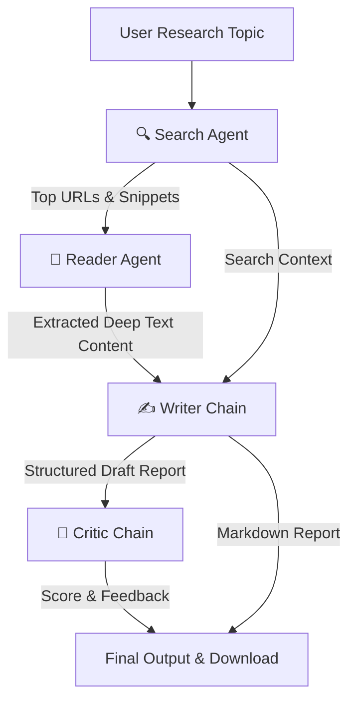

# 🔬 Collaborative AI Research Platform (ResearchMind)

An autonomous, multi-agent AI research platform powered by **LangGraph**, **LangChain**, and **Streamlit**. ResearchMind coordinates specialized AI agents that collaboratively search the live web, extract deep article content, draft structured research reports, and perform quality critique reviews.

---

## 🚀 Key Features

- **Multi-Agent Orchestration**: Modular agent architecture leveraging LangGraph ReAct agents and LangChain LCEL chains.
- **Live Web Research**: Real-time web discovery via the Tavily Search API.
- **Deep Web Scraping**: Targeted extraction of clean webpage content with BeautifulSoup.
- **Structured Report Generation**: Automatic generation of comprehensive reports featuring Executive Summaries, Key Findings, Conclusions, and full Source Attribution.
- **Automated Peer Review & Quality Critic**: Built-in critic chain scoring the generated report and providing actionable feedback.
- **Modern Interactive Dashboard**: Sleek, glassmorphic Streamlit interface with live pipeline progress tracking and markdown export.

---

## 🏛 Architecture & Agent Workflow



1. **Search Agent (ReAct)**: Queries live web sources using Tavily for up-to-date insights and relevant URLs.
2. **Reader Agent (ReAct)**: Inspects the top search results and scrapes full webpage body text for deeper technical details.
3. **Writer Chain (LCEL)**: Fuses high-level search snippets with deep scraped text to draft a structured, professional report.
4. **Critic Chain (LCEL)**: Evaluates the synthesized report, assigning a score out of 10 along with strengths and improvement notes.

---

## 🛠 Tech Stack

- **Frameworks**: LangGraph, LangChain, Streamlit
- **LLM**: OpenAI GPT-4o-mini
- **Search & Scraping**: Tavily API, BeautifulSoup4, Requests
- **Styling**: Modern CSS with Google Fonts (`Syne`, `DM Sans`, `DM Mono`)

---

## 📦 Getting Started

### 1. Clone the Repository
```bash
git clone https://github.com/smithaherkar/Collaborative-AI-Research-Platform.git
cd Collaborative-AI-Research-Platform
```

### 2. Set Up Virtual Environment
```bash
python -m venv .venv

# On Windows
.venv\Scripts\activate

# On macOS/Linux
source .venv/bin/activate
```

### 3. Install Dependencies
```bash
pip install -r requirements.txt
```

### 4. Configure Environment Variables
Create a `.env` file based on [.env.example](.env.example):
```env
OPENAI_API_KEY=your_openai_api_key_here
TAVILY_API_KEY=your_tavily_api_key_here
```

---

## 🖥 Usage

### Run via Streamlit UI
```bash
streamlit run app.py
```
Open your browser at `http://localhost:8501` to use the interactive dashboard.

### Run via CLI Pipeline
```bash
python pipeline.py
```

---

## 📁 Project Structure

```
.
├── agents.py           # ReAct agents and LangChain chains (Search, Reader, Writer, Critic)
├── app.py              # Streamlit interactive UI application
├── pipeline.py         # Sequential CLI execution pipeline
├── tools.py            # Custom tools for Tavily search and BeautifulSoup scraping
├── requirements.txt    # Project dependencies
├── .env.example        # Environment variable template
├── .gitignore          # Git ignore rules
└── README.md           # Project documentation
```

---

## 📄 License
This project is open source and available under the MIT License.
